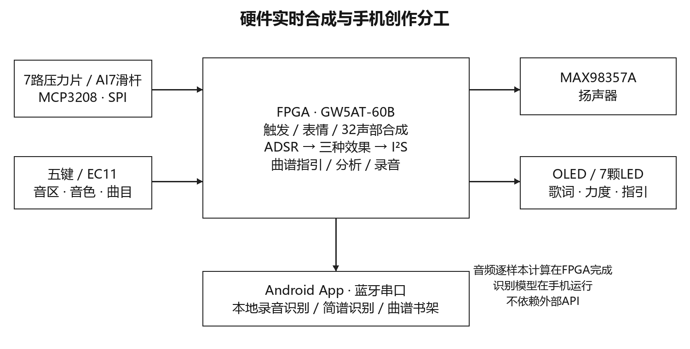
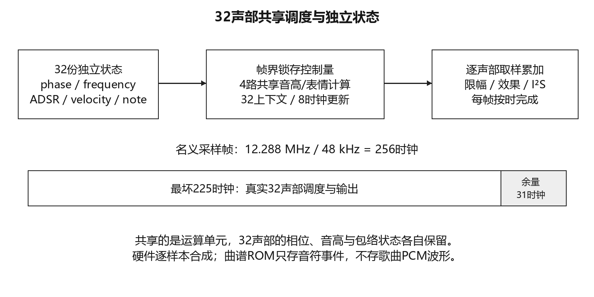
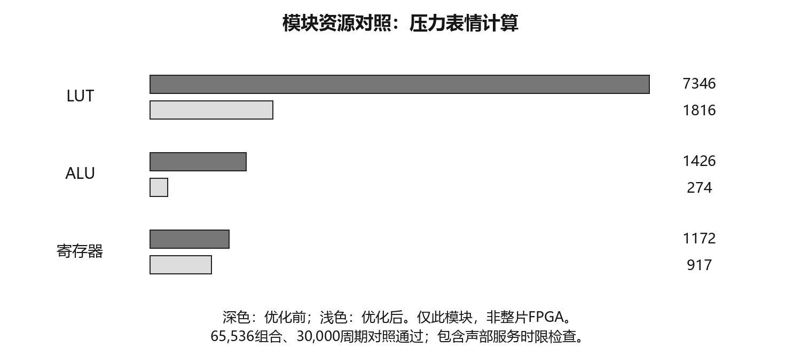

# 声芯乐动 / Soundcore FPGA Instrument

纯HDL多维交互乐器：32个独立声部、七路压力输入、滑杆、EC11、五键、OLED、LED、I²S扬声器与Android原生App。

## 版本和证据边界
本提交基础为B713（GW5AT-60B，MAX98357A）与Android 0.24-scope-lab。布局布线、RTL和软件测试证据位于evidence。B713存在SRAM成功下载读回记录，未据此宣称真实音频或5ms延迟已验收。Flash仍需根据板上实际记录确认。

## 从源码开始
1. 解压路径建议仅含英文。`fpga`是当前唯一正式构建入口；`research/board`等包含历史实验，不应直接用于烧录。
2. 在`fpga`执行`python configure.py`，使冻结的文件/ROM引用指向本机路径。用支持GW5AT-60B的Gowin IDE打开soundcore.gprj，顶层soundcore_speaker_omr_top；或在此目录运行`gw_sh build.tcl`。保留CST；不要在未核对实板时改针或上电。
3. Android需要JDK17、Gradle8.13和Android SDK36（minSdk26）。在android运行`gradle :app:assembleDebug`；测试`gradle :app:testDebugUnitTest`。sdk.dir写入本机local.properties，不提交SDK或凭据。首次构建需要下载开源依赖，安装后的内置识别不需云API。
4. Python研究算法：进入research，`python -m pip install -e .`。运行原生测试还需pytest、Pillow。部分历史脚本使用原开发目录，不是便携构建入口。用户提供的原始音频、照片和私人样本不随代码分发。

## 结构
- fpga/src：B713冻结HDL、约束、IP包装及必要表/模型/曲谱ROM。
- android：完整活动App源码、内置ONNX/OCR模型、30首公版书架数据、单元测试及界面快照。
- research：算法、训练/导出、仿真测试台及历史实验源码。完整竞赛RAR比公开仓库保留更多历史源和内置曲目数据。
- docs：接线数据、赛题原文快照、实现说明。
- evidence：原始冻结哈希、路径迁移说明、PNR、回归摘要与SRAM读回记录。

## 音乐资产和公开版本
完整竞赛RAR保留当前内置曲目事件和歌词数据以供项目复现；不代表授予任何原作品权利。公开GitHub使用公版示例数据，详见PUBLIC_DEMO.md；公开版不与B713曲目ROM位级一致。项目音频实时合成，不将歌曲PCM音频存储回放冒充合成。

## 原创与第三方
共享帧级表情流水线、压力事件策略、识别后事件解码与七键映射、通信及产品集成为项目实现。CREPE Tiny基础权重、Tesseract、ONNX运行时及Gowin厂商IP不冒称原创。许可和归属见THIRD_PARTY_NOTICES.md。MIT仅覆盖有权许可的项目原创代码，不改变第三方条款。

## 更新
修改源码后提交新commit并重新生成报告/证据，记录固件UserCode与App版本。实验室数据只能填写实测，不以仿真或图形渲染替代。

## 架构与资源证据

本模块LUT 7346→1816；不是全片资源下降75.3%。CLS 96%、BSRAM97%，扩展空间有限。数字验证和实物测量分开报告。
